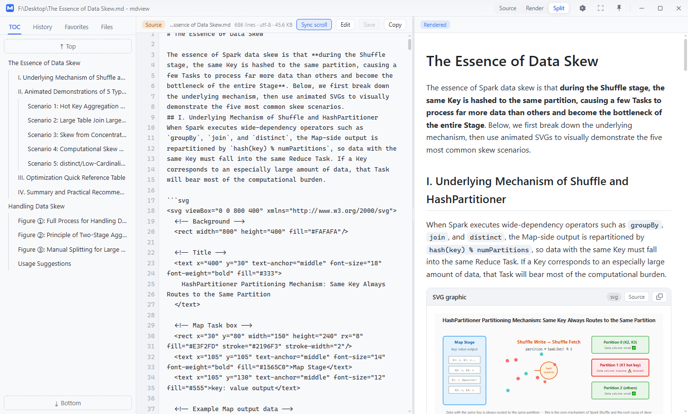
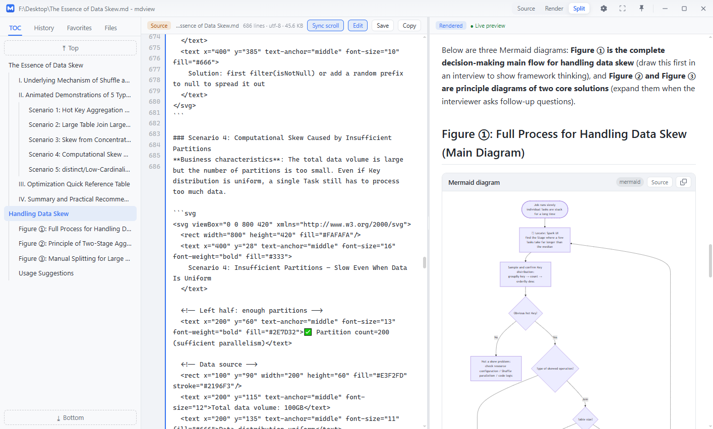
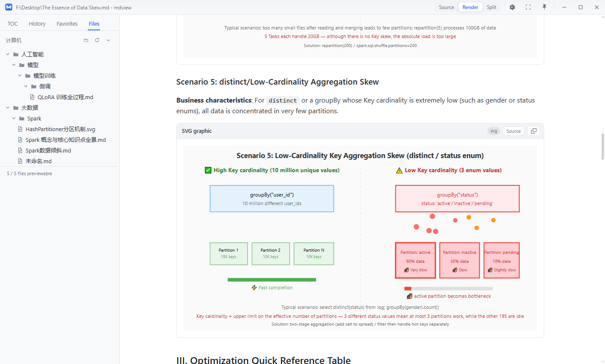
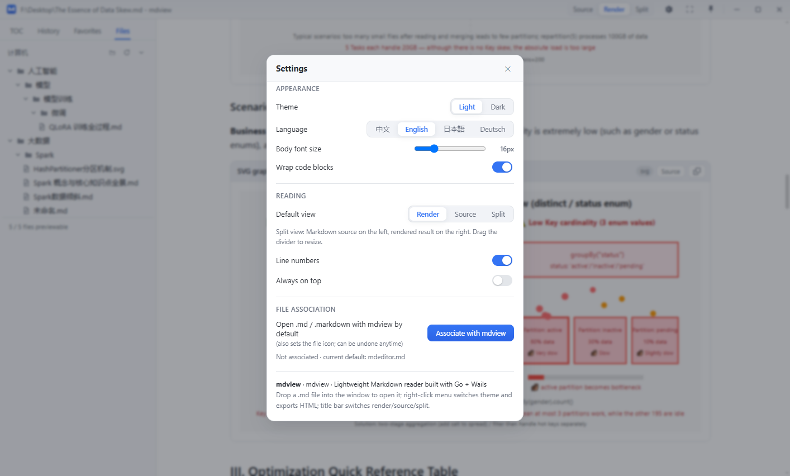
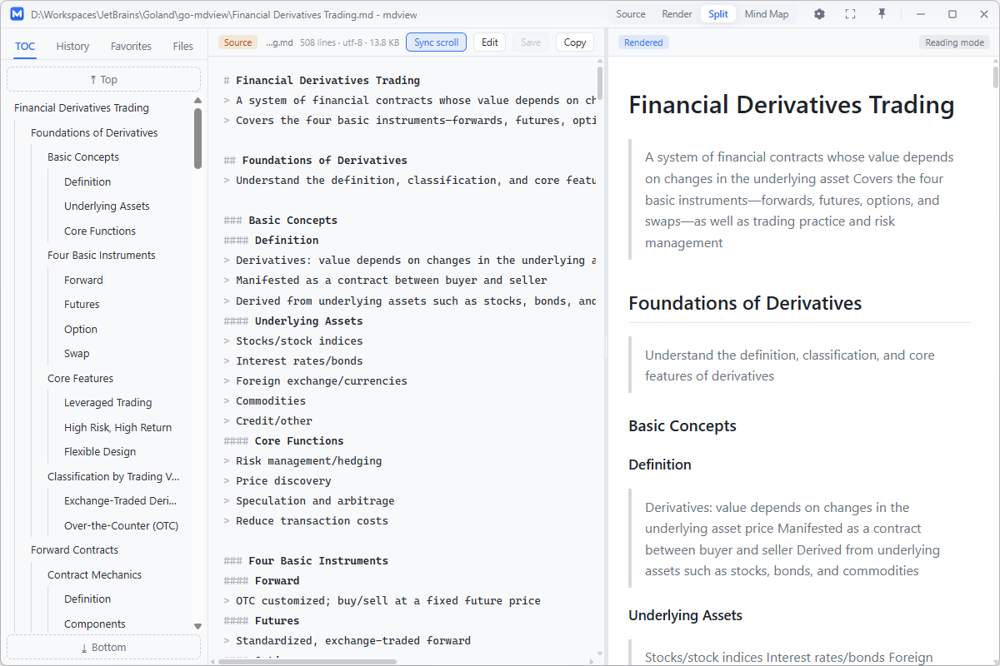
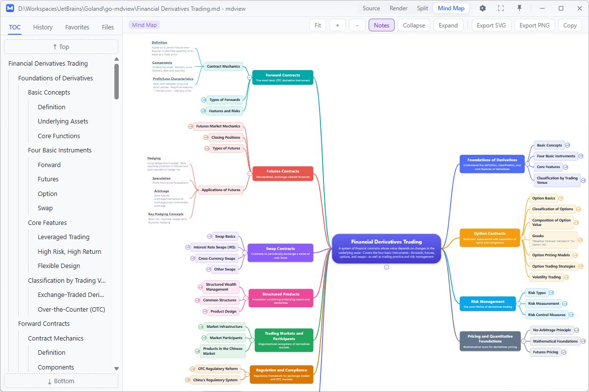

# mdview

**Read Markdown like a web page — instantly, offline, and entirely on your own machine.**

A lightweight native Markdown reader for Windows. Double-click a `.md` file and it opens *rendered* — not in an editor — with diagrams, math, mind maps, and live preview built in.


[简体中文](README.zh-CN.md) · **English**

---

## Why mdview

- **Double-click to read** — associate `.md` with mdview once, and every note opens rendered, like a web page
- **Mind Map view** — one click turns the whole document into an XMind-style mind map, with zoom / pan / collapse / SVG & PNG export
- **Diagrams out of the box** — Mermaid, SVG, KaTeX math, GFM alerts, tables, task lists, footnotes, `[[wiki links]]` — all rendered offline
- **Live preview editing** — rewrite in Split view, watch the preview update instantly, save back in the file's original encoding
- **Folder-friendly** — open a notes folder (e.g. an Obsidian vault) and browse its file tree, history, and favorites
- **Light / dark × 4 languages** — zh-CN / English / 日本語 / Deutsch, switchable live
- **100% local** — one ~13 MB `mdview.exe`, no runtime, no network, no telemetry; your notes never leave your PC

---

## Quick Start

| Method | How |
| --- | --- |
| Double-click | Associate `mdview.exe` with `.md` files (one click in Settings), or drop a file onto the exe |
| Drag & drop | Drag a `.md` file anywhere into the mdview window |
| Send To | `Win+R` → `shell:sendto` → put an `mdview.exe` shortcut there, then right-click an md file → Send To → mdview |
| Command line | `mdview.exe "D:\notes\xxx.md"` |
| Open a folder | Left sidebar "Files" tab → "Open Directory" — pick a notes folder (e.g. an Obsidian vault) and all `.md` files are listed automatically |

**Single instance**: double-clicking again won't open a new window — the file is handed to the already-running one.

---

## Interface at a Glance

Custom draggable title bar up top, four tabs down the left, content on the right (rendered body centered at 900px). Shown here in Split view, with the source-pane toolbar offering Sync scroll / Edit / Save / Copy:



### Four view modes

`Source` · `Render` · `Split` · `Mind Map` (grayed out when no file is open; Mind Map applies to Markdown only):

- **Render** — rendered result only (default)
- **Source** — raw Markdown with path, line count / encoding / size, one-click copy-all; line numbers toggle in Settings
- **Split** — source left, rendered right, draggable divider (double-click to split evenly); **Sync scroll** keeps both panes aligned by heading anchors
- **Mind Map** — the whole document as an XMind-style mind map (see below)

### Live editing (Split view)

Click **Edit** to rewrite the Markdown on the left while the right pane previews instantly. Changes stay preview-only until **Save** writes them back to the original file (GB18030 notes are saved in their original encoding via an atomic replace). Switching files with unsaved edits warns before discarding. Each pane remembers its own scroll position across switches.

### Four sidebar tabs

- **TOC** — auto-extracted heading outline, highlights the current section while scrolling, click to smooth-scroll
- **History** — recently opened files (up to 100) with directory and relative time; keyword filter, clear-all
- **Favorites** — right-click any file to favorite; entries show a ★ to unfavorite in one click
- **Files** — file tree of the current directory (Markdown plus previewable images/text; hidden and junk directories like `.obsidian` / `.git` / `node_modules` are skipped); the open file gets a "current" badge; supports open directory / refresh / collapse all

### Title bar buttons

Four view modes, then `⚙ Settings` · `⛶ Fullscreen` · `📌 Always on top` · `─ Minimize` · `□ Maximize` · `✕ Close` (double-click the title bar = maximize/restore).

### Context menus

- **On content** — light/dark theme toggle · enter/exit Split view · copy file path · open containing folder · export HTML
- **On Files / History / Favorites entries** — open · favorite/unfavorite · copy file path · open containing folder

### More screenshots

**Mermaid & SVG diagrams** render inline as cards; each card header has a **Source** button to flip between the graphic and its code, plus a copy button:



**Files panel** — a directory tree of your notes folder (left) alongside the rendered document (right), here showing an inline SVG graphic:



**Settings** — theme, UI language, body font size, code wrap, default view, line numbers, always-on-top, and one-click `.md` file association:



**Mind Map** — headings (`#`–`######`) become nodes, `>` quotes become node notes; top-level branches are balanced left/right with organic curves. Below: the same document in Split view, then as a mind map:





---

## Rendering Capabilities

- **Full GFM** — tables (rounded borders), strikethrough, task lists (checkable style), autolinks
- **Code blocks** — highlight.js syntax highlighting (github / github-dark themes follow the global theme), language label, hover copy button
- **GFM Alerts** — `> [!NOTE] / [!TIP] / [!IMPORTANT] / [!WARNING] / [!CAUTION]` callouts in five colors
- **Math** — `$inline$` and `$$block$$` via KaTeX, rendered offline
- **Mermaid diagrams** — ```mermaid blocks render as card-style diagrams (falls back to source on syntax errors)
- **SVG graphics** — ```svg (or xml/html blocks containing `<svg>`) render directly as graphic cards
- **Diagram cards** — every graphic card has a **Source** toggle plus a copy button
- **Extras** — footnotes `[^1]`, `==highlight==`, `[[wiki links]]` (resolved by title within the current directory, navigate automatically)
- **Mind Map** — heading levels become nodes, `>` quotes become node notes, top-level branches balanced left/right; wheel to zoom, drag to pan, click a node to collapse/expand; toolbar: fit / zoom / notes toggle / collapse / expand-all / export SVG / export PNG / copy SVG (zero extra dependencies, rendered offline)
- **Local images** — PNG/JPG/SVG/GIF/WebP in the md file's directory and subdirectories display directly via a built-in local route; files never leave your machine
- **Standalone preview** — opening an image file shows it in a lightbox; opening a plain-text file shows it as-is
- **Theming** — global light/dark toggle (code highlight theme follows), font size 12–28px, code word-wrap toggle — all auto-saved
- **i18n** — UI in Simplified Chinese / English / Japanese / German, switchable live in Settings

---

## FAQ

**Q1: Double-clicking an md file doesn't open mdview?**
Open "⚙ Settings → File Association" and click "Associate with mdview" (writes to `HKEY_CURRENT_USER`, no admin rights needed; "Unassociate" restores the previous default). Or manually: right-click the md file → Open With → choose mdview.exe → check "Always use this app".

**Q2: Do old notes with Chinese/GBK encoding show mojibake?**
UTF-8 / GB18030 is auto-detected; no manual conversion needed.

**Q3: A History entry won't open after the file was moved/deleted?**
Missing files in History and Favorites appear grayed out; clicking shows a "file not found" message.

**Q4: Can I edit the Markdown?**
Yes — switch to **Split** view, click **Edit**, and the right pane previews your changes live; **Save** writes them back to the original file (original encoding preserved). It's a lightweight in-place editor, not a full authoring suite — for heavy editing open the file in your own editor.

**Q5: Where are settings and data stored?**
`%AppData%\mdview\` (settings.json / history.json / favorites.json); delete them to reset.

**Q6: Clicking a wiki link `[[some note]]` does nothing?**
Wiki links search the directory of the currently open file recursively for an md with a matching name (without extension); a message appears if not found. Make sure the target note is in the same directory tree.

---

## Known Limitations

Stated honestly:

- Editing is a lightweight in-place source editor (Split view → Edit/Save), not a full authoring tool; other official mdview Pro features (PDF export, archive management, etc.) are out of scope for this clone
- HTML export is a simplified single-file layout (embedded base styles), not the official "bundle-with-images" capability
- Large Mermaid diagrams take 1–2 seconds to parse on first render (the ~2.7MB library is bundled — no network dependency)

---

## Building from Source

```
go-mdview/
├── main.go                   # Wails entry (frameless window, single instance, embed)
├── internal/app/             # Binding layer exposed to the frontend (App.*)
├── internal/mdv/             # Domain logic (settings/history/favorites/file tree/encoding detection/image serving/export/association)
│   └── *_test.go             # Go unit tests
├── frontend/src/             # Vue 3 + TS SPA (title bar/four tabs/render pipeline)
├── frontend/public/static/   # highlight.js / KaTeX / mermaid local libraries
├── build.ps1                 # One-click Windows build (-Clean / -Package)
└── wails.json / go.mod
```

```powershell
# Requires: Go 1.25+, Node 18+, pnpm, (recommended) wails CLI v2
.\build.ps1            # Incremental build (icons if missing → frontend → exe)
.\build.ps1 -Clean     # Clean build
.\build.ps1 -Package   # Build + zip
```

The script checks the icon assets (`build/appicon.png`, `build/windows/icon.ico`, `build/mdview.markdown.png`) and runs `generate-icon.ps1` only when any of them is missing (otherwise it skips with a message), then runs `pnpm install && pnpm run build` in `frontend/` (vue-tsc type check + vite build), then `wails build` (falling back to `go build -tags "desktop,production"` if the wails CLI is missing). Output: `build\bin\mdview.exe`.

Run Go tests: `go test ./internal/mdv/`.

---

*mdview clone · Built with Go + Wails · Files are processed 100% locally — no data is ever uploaded*
