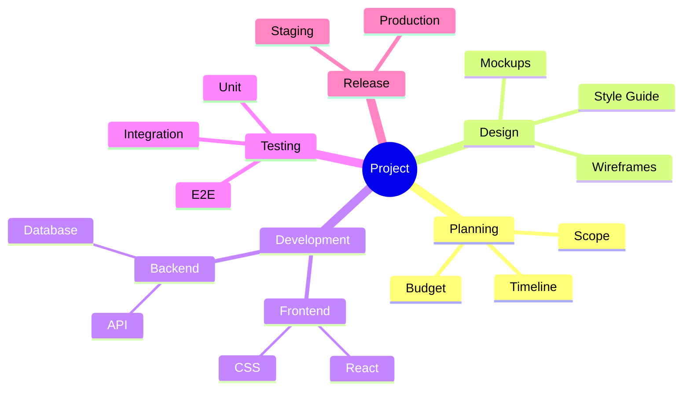
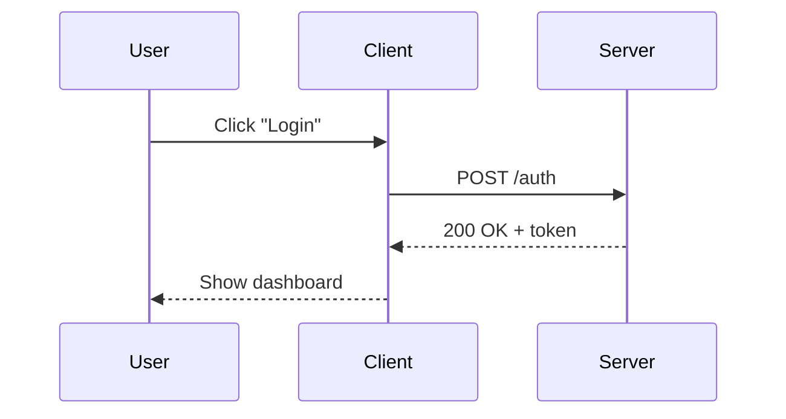
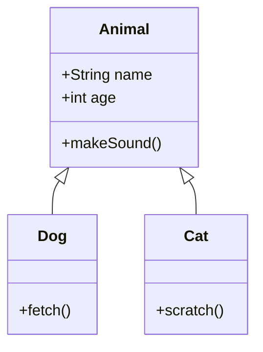
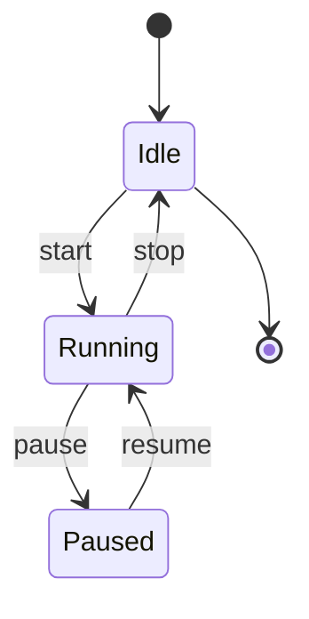
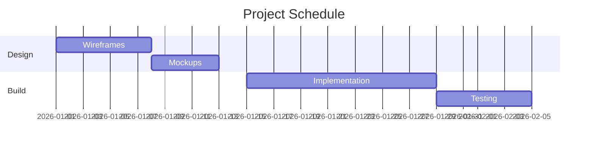
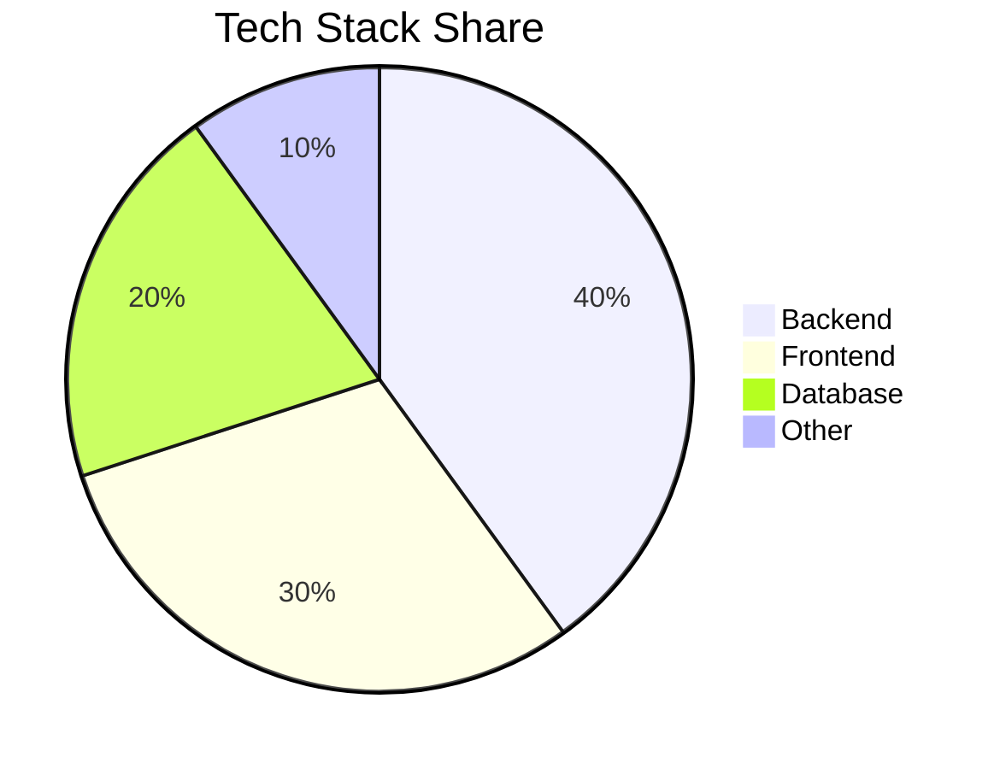
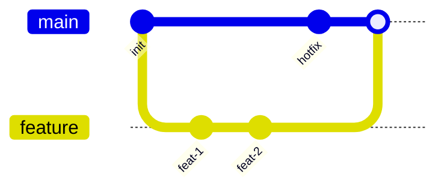
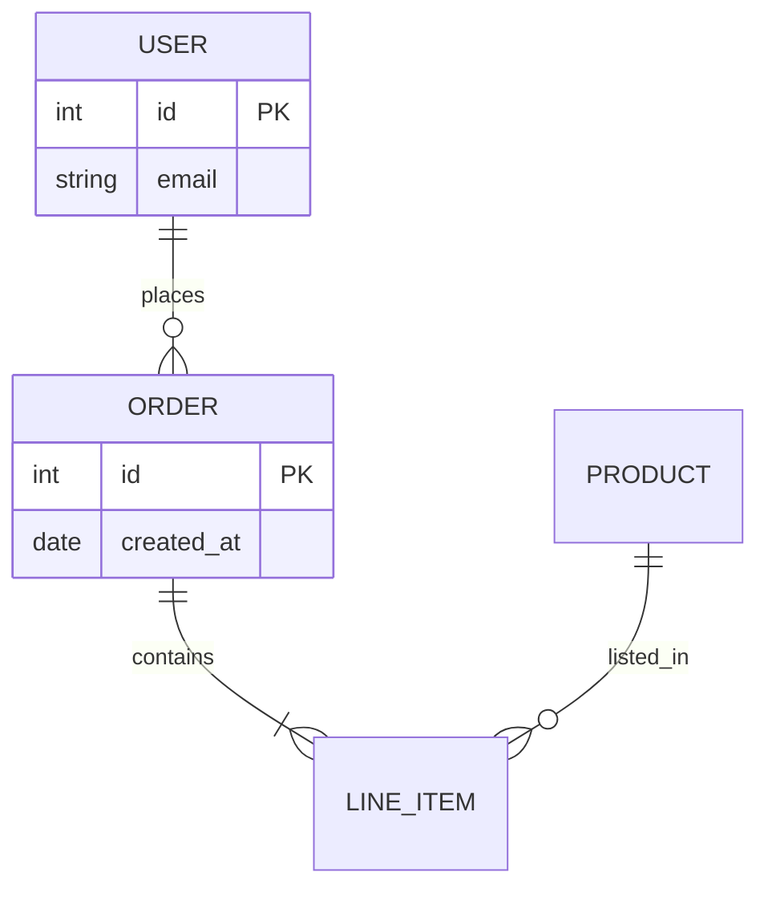

# Test Markdown Document

> A comprehensive sample used to verify Markdown rendering: multiple **Mermaid** diagram types, fenced code blocks with language identifiers, tables, and assorted inline formatting.

---

## 1. Text Formatting

You can use *italics*, **bold**, ***bold italics***, ~~strikethrough~~, `inline code`, and [hyperlinks](https://mermaid.js.org/).

- Unordered list item A
- Unordered list item B
  - Nested item B.1
  - Nested item B.2

1. Ordered step one
2. Ordered step two
3. Ordered step three

---

## 2. Flowchart


---

## 3. Mindmap



---

## 4. Sequence Diagram



---

## 4. Class Diagram



---

## 5. State Diagram



---

## 6. Gantt Chart



---

## 7. Pie Chart



---

## 8. Git Graph



---

## 9. ER Diagram



---

## 10. Code Blocks (with language identifiers)

### Python

```python
def fibonacci(n: int) -> int:
    """Return the n-th Fibonacci number."""
    a, b = 0, 1
    for _ in range(n):
        a, b = b, a + b
    return a


if __name__ == "__main__":
    print([fibonacci(i) for i in range(10)])
```

### JavaScript

```javascript
const greet = (name) => `Hello, ${name}!`;

async function fetchUser(id) {
  const res = await fetch(`/api/users/${id}`);
  if (!res.ok) throw new Error('Request failed');
  return res.json();
}
```

### Bash

```bash
#!/usr/bin/env bash
set -euo pipefail

echo "Building project..."
npm install
npm run build
echo "Done."
```

### SQL

```sql
SELECT u.id, u.email, COUNT(o.id) AS order_count
FROM users u
LEFT JOIN orders o ON o.user_id = u.id
WHERE u.active = TRUE
GROUP BY u.id
ORDER BY order_count DESC;
```

### JSON

```json
{
  "name": "test-app",
  "version": "1.0.0",
  "scripts": {
    "build": "tsc",
    "start": "node dist/index.js"
  }
}
```

---

## 11. Tables

| Feature        | Supported | Notes                     |
| -------------- | :-------: | ------------------------- |
| Flowchart      |    ✅     | Multiple directions       |
| Sequence       |    ✅     | Participants & notes      |
| Code highlight |    ✅     | Language-tagged fences    |
| Tables         |    ✅     | Alignment supported       |

| Left | Center | Right |
| :--- | :----: | ----: |
| L1   |   C1   |    R1 |
| L2   |   C2   |    R2 |

---

## 12. Blockquote & Horizontal Rule

> "Any fool can write code that a computer can understand.
> Good programmers write code that humans can understand."
>
> — _Martin Fowler_

---

## 13. Images & Task Lists


- [x] Write documentation
- [x] Add Mermaid diagrams
- [ ] Review with team
- [ ] Publish release

---

## 14. Footnotes & Escaping

Here is a sentence with a footnote[^1]. Special characters can be escaped: \*not italic\*.

[^1]: This is the footnote content.

---

_End of test document._
