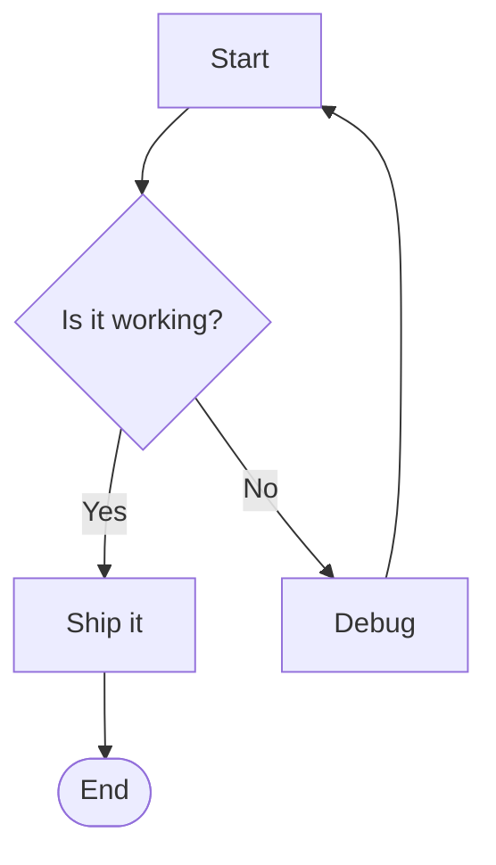
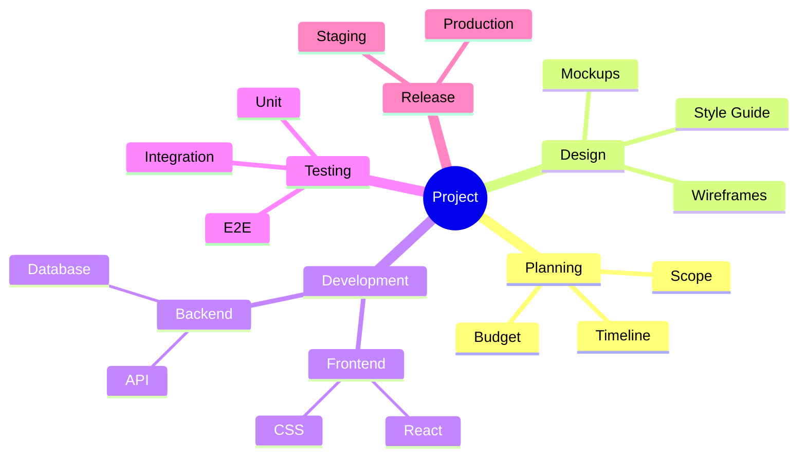
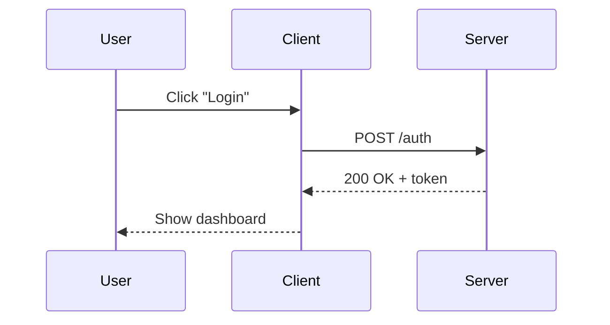
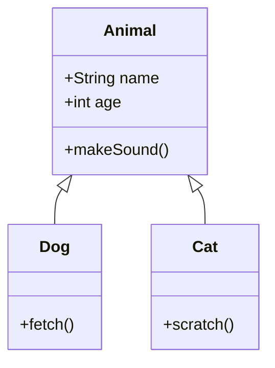
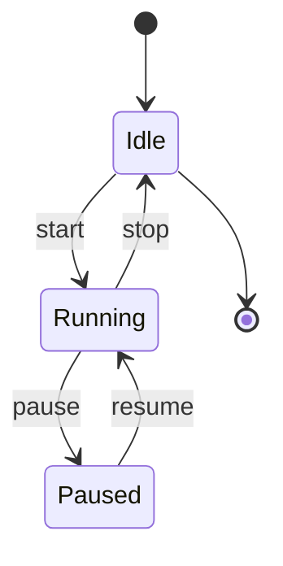
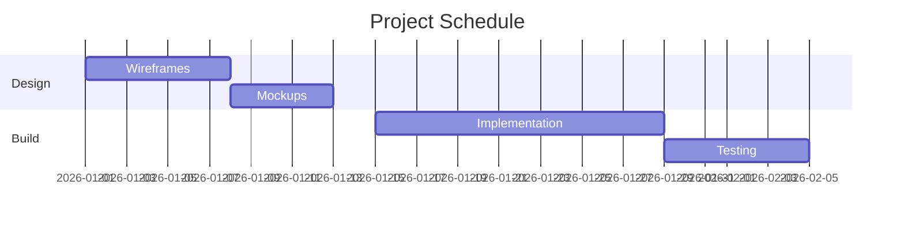
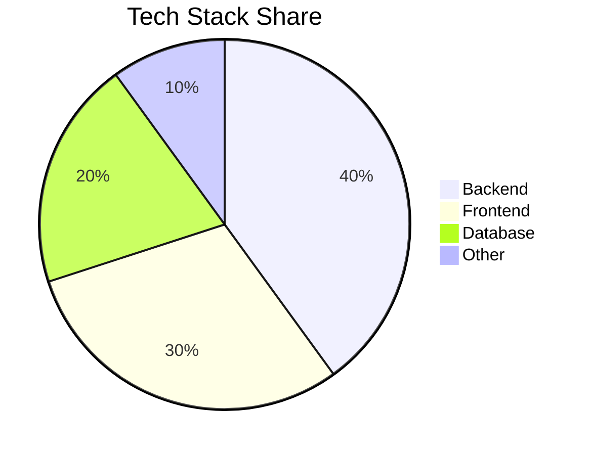
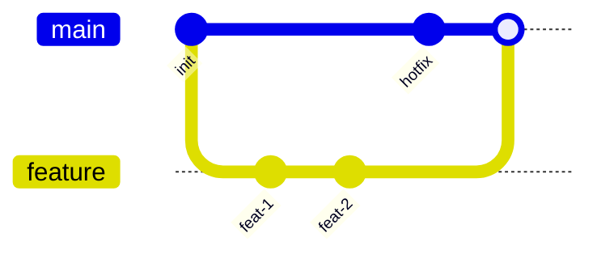
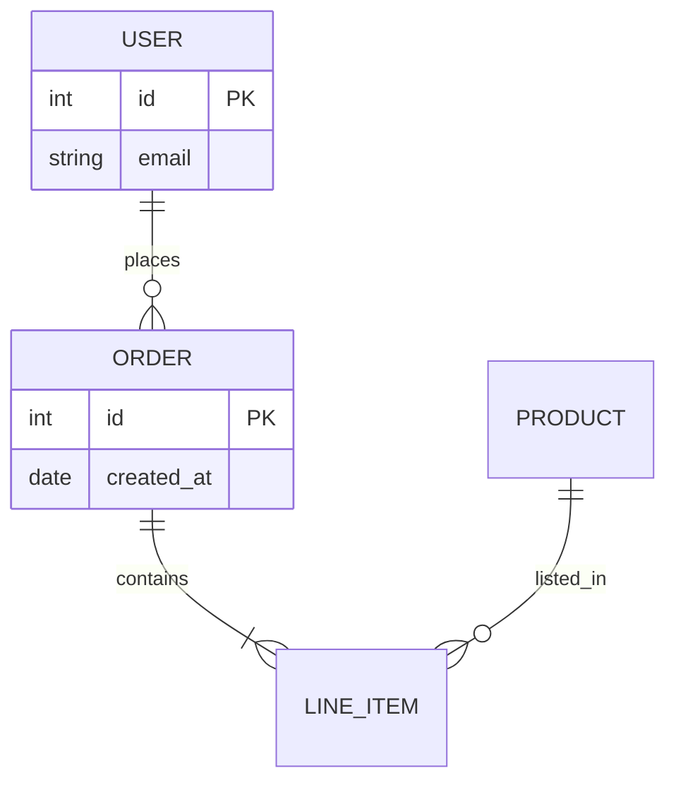

# Test Markdown Document

> A comprehensive sample used to verify Markdown rendering: multiple **Mermaid** diagram types, fenced code blocks with language identifiers, tables, and assorted inline formatting.

---

## 1. Text Formatting

You can use *italics*, **bold**, ***bold italics***, ~~strikethrough~~, `inline code`, and [hyperlinks](https://mermaid.js.org/).

- Unordered list item A
- Unordered list item B
  - Nested item B.1
  - Nested item B.2

1. Ordered step one
2. Ordered step two
3. Ordered step three

---

## 2. Flowchart



---

## 3. Mindmap



---

## 4. Sequence Diagram



---

## 4. Class Diagram



---

## 5. State Diagram



---

## 6. Gantt Chart



---

## 7. Pie Chart



---

## 8. Git Graph



---

## 9. ER Diagram



---

## 10. Code Blocks (with language identifiers)

### Python

```python
def fibonacci(n: int) -> int:
    """Return the n-th Fibonacci number."""
    a, b = 0, 1
    for _ in range(n):
        a, b = b, a + b
    return a


if __name__ == "__main__":
    print([fibonacci(i) for i in range(10)])
```

### JavaScript

```javascript
const greet = (name) => `Hello, ${name}!`;

async function fetchUser(id) {
  const res = await fetch(`/api/users/${id}`);
  if (!res.ok) throw new Error('Request failed');
  return res.json();
}
```

### Bash

```bash
#!/usr/bin/env bash
set -euo pipefail

echo "Building project..."
npm install
npm run build
echo "Done."
```

### SQL

```sql
SELECT u.id, u.email, COUNT(o.id) AS order_count
FROM users u
LEFT JOIN orders o ON o.user_id = u.id
WHERE u.active = TRUE
GROUP BY u.id
ORDER BY order_count DESC;
```

### JSON

```json
{
  "name": "test-app",
  "version": "1.0.0",
  "scripts": {
    "build": "tsc",
    "start": "node dist/index.js"
  }
}
```

---

## 11. Tables

| Feature        | Supported | Notes                     |
| -------------- | :-------: | ------------------------- |
| Flowchart      |    ✅     | Multiple directions       |
| Sequence       |    ✅     | Participants & notes      |
| Code highlight |    ✅     | Language-tagged fences    |
| Tables         |    ✅     | Alignment supported       |

| Left | Center | Right |
| :--- | :----: | ----: |
| L1   |   C1   |    R1 |
| L2   |   C2   |    R2 |

---

## 12. Blockquote & Horizontal Rule

> "Any fool can write code that a computer can understand.
> Good programmers write code that humans can understand."
>
> — _Martin Fowler_

---

## 13. Images & Task Lists


- [x] Write documentation
- [x] Add Mermaid diagrams
- [ ] Review with team
- [ ] Publish release

---

## 14. SVG


### Harness
```svg
<svg xmlns="http://www.w3.org/2000/svg" viewBox="0 0 1200 900" width="1200" height="900"
     font-family="Inter, -apple-system, system-ui, sans-serif">
  <defs>
    <!-- 背景 -->
    <linearGradient id="bgGrad" x1="0%" y1="0%" x2="100%" y2="100%">
      <stop offset="0%" stop-color="#0a0e27"/>
      <stop offset="100%" stop-color="#131a33"/>
    </linearGradient>

    <!-- 分层渐变 -->
    <linearGradient id="aiGrad" x1="0%" y1="0%" x2="0%" y2="100%">
      <stop offset="0%" stop-color="#6366f1" stop-opacity="0.28"/>
      <stop offset="100%" stop-color="#8b5cf6" stop-opacity="0.12"/>
    </linearGradient>
    <linearGradient id="platGrad" x1="0%" y1="0%" x2="0%" y2="100%">
      <stop offset="0%" stop-color="#3b82f6" stop-opacity="0.22"/>
      <stop offset="100%" stop-color="#2563eb" stop-opacity="0.10"/>
    </linearGradient>
    <linearGradient id="infraGrad" x1="0%" y1="0%" x2="0%" y2="100%">
      <stop offset="0%" stop-color="#06b6d4" stop-opacity="0.16"/>
      <stop offset="100%" stop-color="#0891b2" stop-opacity="0.08"/>
    </linearGradient>

    <!-- AI 智能体呼吸光晕 -->
    <radialGradient id="brainGlow" cx="50%" cy="50%" r="50%">
      <stop offset="0%"   stop-color="#22d3ee" stop-opacity="0.7"/>
      <stop offset="60%"  stop-color="#8b5cf6" stop-opacity="0.25"/>
      <stop offset="100%" stop-color="#000000" stop-opacity="0"/>
    </radialGradient>

    <!-- 卡片扫光 -->
    <linearGradient id="sweep" x1="0%" y1="0%" x2="100%" y2="0%">
      <stop offset="0%"  stop-color="#ffffff" stop-opacity="0"/>
      <stop offset="50%" stop-color="#ffffff" stop-opacity="0.14"/>
      <stop offset="100%" stop-color="#ffffff" stop-opacity="0"/>
    </linearGradient>

    <!-- 滤镜 -->
    <filter id="glow" x="-50%" y="-50%" width="200%" height="200%">
      <feGaussianBlur stdDeviation="3" result="b"/>
      <feMerge><feMergeNode in="b"/><feMergeNode in="SourceGraphic"/></feMerge>
    </filter>
    <filter id="bigGlow" x="-60%" y="-60%" width="220%" height="220%">
      <feGaussianBlur stdDeviation="8" result="b"/>
      <feMerge><feMergeNode in="b"/><feMergeNode in="SourceGraphic"/></feMerge>
    </filter>
  </defs>

  <!-- ================= 背景 ================= -->
  <rect width="1200" height="900" fill="url(#bgGrad)"/>
  <!-- 网格 -->
  <g stroke="#1e293b" stroke-opacity="0.35" stroke-width="1">
    <path d="M0 100 H1200 M0 200 H1200 M0 300 H1200 M0 400 H1200 M0 500 H1200 M0 600 H1200 M0 700 H1200 M0 800 H1200"/>
    <path d="M100 0 V900 M200 0 V900 M300 0 V900 M400 0 V900 M500 0 V900 M600 0 V900 M700 0 V900 M800 0 V900 M900 0 V900 M1000 0 V900 M1100 0 V900"/>
  </g>

  <!-- ================= 标题 ================= -->
  <text x="600" y="42" text-anchor="middle" fill="#e2e8f0" font-size="24" font-weight="700" letter-spacing="3">
    HARNESS PLATFORM ARCHITECTURE
  </text>
  <text x="600" y="66" text-anchor="middle" fill="#94a3b8" font-size="13" letter-spacing="2">
    AI-DRIVEN AUTONOMOUS SDLC  ·  UNIFIED SOFTWARE DELIVERY
  </text>

  <!-- ================= LAYER 1 · AI INTELLIGENCE (顶部) ================= -->
  <g>
    <rect x="40" y="90" width="1120" height="170" rx="14" fill="url(#aiGrad)" stroke="#8b5cf6" stroke-opacity="0.5"/>
    <text x="70" y="118" fill="#c4b5fd" font-size="13" font-weight="600" letter-spacing="1.5">AI INTELLIGENCE LAYER</text>

    <!-- 中心 AI 大脑（呼吸 + 脉冲） -->
    <g>
      <circle cx="600" cy="175" r="60" fill="url(#brainGlow)">
        <animate attributeName="opacity" values="0.6;1;0.6" dur="3s" repeatCount="indefinite"/>
      </circle>
      <circle cx="600" cy="175" r="42" fill="none" stroke="#22d3ee" stroke-width="2" filter="url(#glow)">
        <animate attributeName="r" values="42;46;42" dur="3s" repeatCount="indefinite"/>
        <animate attributeName="stroke-opacity" values="0.9;0.4;0.9" dur="3s" repeatCount="indefinite"/>
      </circle>
      <!-- 外扩脉冲环 -->
      <circle cx="600" cy="175" r="42" fill="none" stroke="#8b5cf6" stroke-width="1.5" opacity="0">
        <animate attributeName="r" values="42;80" dur="2.5s" repeatCount="indefinite"/>
        <animate attributeName="opacity" values="0.8;0" dur="2.5s" repeatCount="indefinite"/>
      </circle>
      <circle cx="600" cy="175" r="42" fill="none" stroke="#22d3ee" stroke-width="1.5" opacity="0">
        <animate attributeName="r" values="42;80" dur="2.5s" begin="1.25s" repeatCount="indefinite"/>
        <animate attributeName="opacity" values="0.6;0" dur="2.5s" begin="1.25s" repeatCount="indefinite"/>
      </circle>
      <text x="600" y="170" text-anchor="middle" fill="#22d3ee" font-size="15" font-weight="700">HARNESS AI</text>
      <text x="600" y="188" text-anchor="middle" fill="#a5f3fc" font-size="10">DevOps Agent</text>
      <text x="600" y="202" text-anchor="middle" fill="#818cf8" font-size="9">LLM · Claude / Bedrock / Vertex</text>
    </g>

    <!-- 子智能体（脉冲点） -->
    <g font-size="10" fill="#c7d2fe" text-anchor="middle">
      <rect x="80"  y="140" width="130" height="34" rx="8" fill="#1e1b4b" stroke="#6366f1" stroke-opacity="0.7"/>
      <circle cx="100" cy="157" r="3.5" fill="#22d3ee"><animate attributeName="r" values="3.5;5;3.5" dur="1.6s" repeatCount="indefinite"/></circle>
      <text x="152" y="161">Coding Agents</text>

      <rect x="80"  y="184" width="130" height="34" rx="8" fill="#1e1b4b" stroke="#6366f1" stroke-opacity="0.7"/>
      <circle cx="100" cy="201" r="3.5" fill="#a78bfa"><animate attributeName="r" values="3.5;5;3.5" dur="2s" repeatCount="indefinite"/></circle>
      <text x="148" y="205">Test Intelligence</text>

      <rect x="990" y="140" width="130" height="34" rx="8" fill="#1e1b4b" stroke="#6366f1" stroke-opacity="0.7"/>
      <circle cx="1010" cy="157" r="3.5" fill="#34d399"><animate attributeName="r" values="3.5;5;3.5" dur="1.8s" repeatCount="indefinite"/></circle>
      <text x="1058" y="161">Deployment Verify</text>

      <rect x="990" y="184" width="130" height="34" rx="8" fill="#1e1b4b" stroke="#6366f1" stroke-opacity="0.7"/>
      <circle cx="1010" cy="201" r="3.5" fill="#f472b6"><animate attributeName="r" values="3.5;5;3.5" dur="2.2s" repeatCount="indefinite"/></circle>
      <text x="1062" y="205">Incident Agent</text>
    </g>

    <!-- AI ↔ Platform 数据流（流动虚线） -->
    <g stroke="#22d3ee" stroke-width="1.6" stroke-dasharray="6 6" fill="none" opacity="0.85">
      <line x1="600" y1="217" x2="600" y2="270">
        <animate attributeName="stroke-dashoffset" from="0" to="-24" dur="1.2s" repeatCount="indefinite"/>
      </line>
      <line x1="300" y1="218" x2="300" y2="270">
        <animate attributeName="stroke-dashoffset" from="0" to="-24" dur="1.5s" repeatCount="indefinite"/>
      </line>
      <line x1="900" y1="218" x2="900" y2="270">
        <animate attributeName="stroke-dashoffset" from="0" to="-24" dur="1.4s" repeatCount="indefinite"/>
      </line>
    </g>
  </g>

  <!-- ================= LAYER 2 · HARNESS PLATFORM (中部) ================= -->
  <g>
    <rect x="40" y="280" width="1120" height="330" rx="14" fill="url(#platGrad)" stroke="#3b82f6" stroke-opacity="0.5"/>
    <text x="70" y="308" fill="#93c5fd" font-size="13" font-weight="600" letter-spacing="1.5">HARNESS PLATFORM · CONTROL PLANE</text>

    <!-- 左侧：Platform Core -->
    <g>
      <rect x="60" y="322" width="200" height="270" rx="10" fill="#0f172a" stroke="#1d4ed8" stroke-opacity="0.6"/>
      <text x="160" y="345" text-anchor="middle" fill="#60a5fa" font-size="11" font-weight="700" letter-spacing="1">PLATFORM CORE</text>

      <g font-size="10" fill="#cbd5e1">
        <rect x="75" y="360" width="170" height="28" rx="6" fill="#1e3a8a" fill-opacity="0.4">
          <animate attributeName="fill-opacity" values="0.3;0.6;0.3" dur="4s" repeatCount="indefinite"/>
        </rect>
        <text x="160" y="378" text-anchor="middle">Pipeline Engine</text>

        <rect x="75" y="396" width="170" height="28" rx="6" fill="#1e3a8a" fill-opacity="0.4">
          <animate attributeName="fill-opacity" values="0.3;0.6;0.3" dur="4s" begin="0.5s" repeatCount="indefinite"/>
        </rect>
        <text x="160" y="414" text-anchor="middle">Policy Engine · OPA</text>

        <rect x="75" y="432" width="170" height="28" rx="6" fill="#1e3a8a" fill-opacity="0.4">
          <animate attributeName="fill-opacity" values="0.3;0.6;0.3" dur="4s" begin="1s" repeatCount="indefinite"/>
        </rect>
        <text x="160" y="450" text-anchor="middle">RBAC · Secrets · Audit</text>

        <rect x="75" y="468" width="170" height="28" rx="6" fill="#1e3a8a" fill-opacity="0.4">
          <animate attributeName="fill-opacity" values="0.3;0.6;0.3" dur="4s" begin="1.5s" repeatCount="indefinite"/>
        </rect>
        <text x="160" y="486" text-anchor="middle">Connectors</text>

        <!-- 扫光带 -->
        <rect x="75" y="360" width="170" height="136" rx="6" fill="url(#sweep)">
          <animate attributeName="x" values="75;245;75" dur="6s" repeatCount="indefinite"/>
          <animate attributeName="width" values="0;170;0" dur="6s" repeatCount="indefinite"/>
        </rect>
      </g>

      <text x="160" y="530" text-anchor="middle" fill="#64748b" font-size="8.5">Governance · Compliance</text>
      <text x="160" y="545" text-anchor="middle" fill="#64748b" font-size="8.5">Template Library</text>
      <text x="160" y="560" text-anchor="middle" fill="#64748b" font-size="8.5">Audit Trail</text>
    </g>

    <!-- 中部：Modules 4x2 网格 -->
    <g font-size="10">
      <text x="620" y="345" text-anchor="middle" fill="#60a5fa" font-size="11" font-weight="700" letter-spacing="1">DELIVERY MODULES</text>
      <g fill="#dbeafe" text-anchor="middle">
        <!-- Row 1 -->
        <rect x="285" y="360" width="155" height="50" rx="8" fill="#1e3a8a" fill-opacity="0.35" stroke="#3b82f6" stroke-opacity="0.4">
          <animate attributeName="fill-opacity" values="0.25;0.55;0.25" dur="5s" repeatCount="indefinite"/>
        </rect>
        <text x="362" y="381" font-weight="600">CI</text><text x="362" y="397" font-size="8.5" fill="#93c5fd">Build &amp; Test Automation</text>

        <rect x="455" y="360" width="155" height="50" rx="8" fill="#1e3a8a" fill-opacity="0.35" stroke="#3b82f6" stroke-opacity="0.4">
          <animate attributeName="fill-opacity" values="0.25;0.55;0.25" dur="5s" begin="0.4s" repeatCount="indefinite"/>
        </rect>
        <text x="532" y="381" font-weight="600">CD</text><text x="532" y="397" font-size="8.5" fill="#93c5fd">Deploy &amp; Rollback</text>

        <rect x="625" y="360" width="155" height="50" rx="8" fill="#1e3a8a" fill-opacity="0.35" stroke="#3b82f6" stroke-opacity="0.4">
          <animate attributeName="fill-opacity" values="0.25;0.55;0.25" dur="5s" begin="0.8s" repeatCount="indefinite"/>
        </rect>
        <text x="702" y="381" font-weight="600">IaCM</text><text x="702" y="397" font-size="8.5" fill="#93c5fd">Infra as Code</text>

        <rect x="795" y="360" width="155" height="50" rx="8" fill="#1e3a8a" fill-opacity="0.35" stroke="#3b82f6" stroke-opacity="0.4">
          <animate attributeName="fill-opacity" values="0.25;0.55;0.25" dur="5s" begin="1.2s" repeatCount="indefinite"/>
        </rect>
        <text x="872" y="381" font-weight="600">IDP</text><text x="872" y="397" font-size="8.5" fill="#93c5fd">Internal Developer Portal</text>

        <!-- Row 2 -->
        <rect x="285" y="425" width="155" height="50" rx="8" fill="#1e3a8a" fill-opacity="0.35" stroke="#3b82f6" stroke-opacity="0.4">
          <animate attributeName="fill-opacity" values="0.25;0.55;0.25" dur="5s" begin="1.6s" repeatCount="indefinite"/>
        </rect>
        <text x="362" y="446" font-weight="600">Chaos Eng</text><text x="362" y="462" font-size="8.5" fill="#93c5fd">Resilience Testing</text>

        <rect x="455" y="425" width="155" height="50" rx="8" fill="#1e3a8a" fill-opacity="0.35" stroke="#3b82f6" stroke-opacity="0.4">
          <animate attributeName="fill-opacity" values="0.25;0.55;0.25" dur="5s" begin="2s" repeatCount="indefinite"/>
        </rect>
        <text x="532" y="446" font-weight="600">Feature Flags</text><text x="532" y="462" font-size="8.5" fill="#93c5fd">Management &amp; Exp</text>

        <rect x="625" y="425" width="155" height="50" rx="8" fill="#1e3a8a" fill-opacity="0.35" stroke="#3b82f6" stroke-opacity="0.4">
          <animate attributeName="fill-opacity" values="0.25;0.55;0.25" dur="5s" begin="2.4s" repeatCount="indefinite"/>
        </rect>
        <text x="702" y="446" font-weight="600">STO</text><text x="702" y="462" font-size="8.5" fill="#93c5fd">Security Testing Orch</text>

        <rect x="795" y="425" width="155" height="50" rx="8" fill="#1e3a8a" fill-opacity="0.35" stroke="#3b82f6" stroke-opacity="0.4">
          <animate attributeName="fill-opacity" values="0.25;0.55;0.25" dur="5s" begin="2.8s" repeatCount="indefinite"/>
        </rect>
        <text x="872" y="446" font-weight="600">CCM</text><text x="872" y="462" font-size="8.5" fill="#93c5fd">Cloud Cost Mgmt</text>

        <!-- Row 3 -->
        <rect x="285" y="490" width="155" height="50" rx="8" fill="#1e3a8a" fill-opacity="0.35" stroke="#3b82f6" stroke-opacity="0.4">
          <animate attributeName="fill-opacity" values="0.25;0.55;0.25" dur="5s" begin="3.2s" repeatCount="indefinite"/>
        </rect>
        <text x="362" y="511" font-weight="600">Code Repo</text><text x="362" y="527" font-size="8.5" fill="#93c5fd">Git Native</text>

        <rect x="455" y="490" width="155" height="50" rx="8" fill="#1e3a8a" fill-opacity="0.35" stroke="#3b82f6" stroke-opacity="0.4">
          <animate attributeName="fill-opacity" values="0.25;0.55;0.25" dur="5s" begin="3.6s" repeatCount="indefinite"/>
        </rect>
        <text x="532" y="511" font-weight="600">SSCA</text><text x="532" y="527" font-size="8.5" fill="#93c5fd">Supply Chain Assurance</text>

        <rect x="625" y="490" width="155" height="50" rx="8" fill="#1e3a8a" fill-opacity="0.35" stroke="#3b82f6" stroke-opacity="0.4">
          <animate attributeName="fill-opacity" values="0.25;0.55;0.25" dur="5s" begin="4s" repeatCount="indefinite"/>
        </rect>
        <text x="702" y="511" font-weight="600">DB DevOps</text><text x="702" y="527" font-size="8.5" fill="#93c5fd">Schema Migrations</text>

        <rect x="795" y="490" width="155" height="50" rx="8" fill="#1e3a8a" fill-opacity="0.35" stroke="#3b82f6" stroke-opacity="0.4">
          <animate attributeName="fill-opacity" values="0.25;0.55;0.25" dur="5s" begin="4.4s" repeatCount="indefinite"/>
        </rect>
        <text x="872" y="511" font-weight="600">SRM</text><text x="872" y="527" font-size="8.5" fill="#93c5fd">Service Reliability</text>
      </g>
    </g>

    <!-- 右侧：Harness Delegate -->
    <g>
      <rect x="970" y="322" width="170" height="270" rx="10" fill="#0f172a" stroke="#0891b2" stroke-opacity="0.6"/>
      <text x="1055" y="345" text-anchor="middle" fill="#22d3ee" font-size="11" font-weight="700" letter-spacing="1">HARNESS DELEGATE</text>
      <text x="1055" y="360" text-anchor="middle" fill="#64748b" font-size="8.5">Runs in customer VPC</text>

      <g font-size="10" fill="#cbd5e1" text-anchor="middle">
        <rect x="985" y="375" width="140" height="28" rx="6" fill="#155e75" fill-opacity="0.4">
          <animate attributeName="fill-opacity" values="0.3;0.6;0.3" dur="3s" repeatCount="indefinite"/>
        </rect>
        <text x="1055" y="393">GitOps Agent</text>

        <rect x="985" y="411" width="140" height="28" rx="6" fill="#155e75" fill-opacity="0.4">
          <animate attributeName="fill-opacity" values="0.3;0.6;0.3" dur="3s" begin="0.5s" repeatCount="indefinite"/>
        </rect>
        <text x="1055" y="429">Build Runner</text>

        <rect x="985" y="447" width="140" height="28" rx="6" fill="#155e75" fill-opacity="0.4">
          <animate attributeName="fill-opacity" values="0.3;0.6;0.3" dur="3s" begin="1s" repeatCount="indefinite"/>
        </rect>
        <text x="1055" y="465">Verification Probe</text>
      </g>

      <circle cx="1055" cy="520" r="18" fill="none" stroke="#22d3ee" stroke-width="1.5">
        <animate attributeName="r" values="18;24;18" dur="2.5s" repeatCount="indefinite"/>
        <animate attributeName="stroke-opacity" values="0.8;0.3;0.8" dur="2.5s" repeatCount="indefinite"/>
      </circle>
      <circle cx="1055" cy="520" r="6" fill="#22d3ee">
        <animate attributeName="opacity" values="1;0.5;1" dur="2s" repeatCount="indefinite"/>
      </circle>
      <text x="1055" y="566" text-anchor="middle" fill="#64748b" font-size="8">Outbound-only</text>
      <text x="1055" y="580" text-anchor="middle" fill="#64748b" font-size="8">Secure connection</text>
    </g>
  </g>

  <!-- ================= 平台 → 基础设施 连接 ================= -->
  <g stroke="#0891b2" stroke-width="1.5" stroke-dasharray="5 5" fill="none" opacity="0.8">
    <line x1="200" y1="610" x2="200" y2="660">
      <animate attributeName="stroke-dashoffset" from="0" to="-20" dur="1.3s" repeatCount="indefinite"/>
    </line>
    <line x1="500" y1="610" x2="500" y2="660">
      <animate attributeName="stroke-dashoffset" from="0" to="-20" dur="1.5s" repeatCount="indefinite"/>
    </line>
    <line x1="800" y1="610" x2="800" y2="660">
      <animate attributeName="stroke-dashoffset" from="0" to="-20" dur="1.2s" repeatCount="indefinite"/>
    </line>
    <line x1="1100" y1="610" x2="1100" y2="660">
      <animate attributeName="stroke-dashoffset" from="0" to="-20" dur="1.4s" repeatCount="indefinite"/>
    </line>
  </g>

  <!-- ================= LAYER 3 · TARGET INFRA (底部) ================= -->
  <g>
    <rect x="40" y="670" width="1120" height="170" rx="14" fill="url(#infraGrad)" stroke="#06b6d4" stroke-opacity="0.5"/>
    <text x="70" y="698" fill="#67e8f9" font-size="13" font-weight="600" letter-spacing="1.5">TARGET INFRASTRUCTURE</text>

    <g font-size="10" fill="#cffafe" text-anchor="middle">
      <!-- Clouds -->
      <rect x="70"  y="715" width="160" height="48" rx="10" fill="#164e63" fill-opacity="0.5" stroke="#06b6d4" stroke-opacity="0.4">
        <animate attributeName="fill-opacity" values="0.35;0.6;0.35" dur="4s" repeatCount="indefinite"/>
      </rect>
      <text x="150" y="737" font-weight="600">AWS</text>
      <text x="150" y="752" font-size="8.5" fill="#67e8f9">ECS · EKS · Lambda</text>

      <rect x="250" y="715" width="160" height="48" rx="10" fill="#164e63" fill-opacity="0.5" stroke="#06b6d4" stroke-opacity="0.4">
        <animate attributeName="fill-opacity" values="0.35;0.6;0.35" dur="4s" begin="0.6s" repeatCount="indefinite"/>
      </rect>
      <text x="330" y="737" font-weight="600">GCP</text>
      <text x="330" y="752" font-size="8.5" fill="#67e8f9">GKE · Cloud Run</text>

      <rect x="430" y="715" width="160" height="48" rx="10" fill="#164e63" fill-opacity="0.5" stroke="#06b6d4" stroke-opacity="0.4">
        <animate attributeName="fill-opacity" values="0.35;0.6;0.35" dur="4s" begin="1.2s" repeatCount="indefinite"/>
      </rect>
      <text x="510" y="737" font-weight="600">Azure</text>
      <text x="510" y="752" font-size="8.5" fill="#67e8f9">AKS · App Service</text>

      <!-- Kubernetes -->
      <rect x="610" y="715" width="160" height="48" rx="10" fill="#164e63" fill-opacity="0.5" stroke="#06b6d4" stroke-opacity="0.4">
        <animate attributeName="fill-opacity" values="0.35;0.6;0.35" dur="4s" begin="1.8s" repeatCount="indefinite"/>
      </rect>
      <text x="690" y="737" font-weight="600">Kubernetes</text>
      <text x="690" y="752" font-size="8.5" fill="#67e8f9">Helm · ArgoCD</text>

      <!-- Data & Observability -->
      <rect x="790" y="715" width="160" height="48" rx="10" fill="#164e63" fill-opacity="0.5" stroke="#06b6d4" stroke-opacity="0.4">
        <animate attributeName="fill-opacity" values="0.35;0.6;0.35" dur="4s" begin="2.4s" repeatCount="indefinite"/>
      </rect>
      <text x="870" y="737" font-weight="600">Databases</text>
      <text x="870" y="752" font-size="8.5" fill="#67e8f9">RDS · MongoDB</text>

      <rect x="970" y="715" width="160" height="48" rx="10" fill="#164e63" fill-opacity="0.5" stroke="#06b6d4" stroke-opacity="0.4">
        <animate attributeName="fill-opacity" values="0.35;0.6;0.35" dur="4s" begin="3s" repeatCount="indefinite"/>
      </rect>
      <text x="1050" y="737" font-weight="600">Observability</text>
      <text x="1050" y="752" font-size="8.5" fill="#67e8f9">Datadog · Prometheus</text>
    </g>

    <text x="600" y="815" text-anchor="middle" fill="#475569" font-size="9">
      Feedback loop · Metrics · Logs · Traces → AI Intelligence Layer
    </text>
    <!-- 反馈回路 -->
    <path d="M 1150 810 Q 1180 500 1150 190" fill="none" stroke="#8b5cf6" stroke-width="1" stroke-dasharray="3 5" opacity="0.4">
      <animate attributeName="stroke-dashoffset" from="0" to="-16" dur="2s" repeatCount="indefinite"/>
    </path>
  </g>

  <!-- ================= 图例 ================= -->
  <g font-size="9" fill="#64748b">
    <circle cx="70"  cy="865" r="4" fill="#22d3ee"><animate attributeName="r" values="4;5.5;4" dur="1.5s" repeatCount="indefinite"/></circle>
    <text x="82"  y="868">AI Agent Activity</text>
    <rect x="190" y="861" width="20" height="6" fill="none" stroke="#22d3ee" stroke-dasharray="4 4">
      <animate attributeName="stroke-dashoffset" from="0" to="-8" dur="1s" repeatCount="indefinite"/>
    </rect>
    <text x="218" y="868">Data Flow</text>
    <rect x="300" y="858" width="14" height="12" rx="3" fill="#1e3a8a" fill-opacity="0.5" stroke="#3b82f6">
      <animate attributeName="fill-opacity" values="0.3;0.7;0.3" dur="4s" repeatCount="indefinite"/>
    </rect>
    <text x="322" y="868">Module Pulse</text>
    <circle cx="420" cy="865" r="8" fill="none" stroke="#8b5cf6" stroke-width="1">
      <animate attributeName="r" values="8;14;8" dur="2.5s" repeatCount="indefinite"/>
      <animate attributeName="opacity" values="0.8;0.2;0.8" dur="2.5s" repeatCount="indefinite"/>
    </circle>
    <text x="438" y="868">Deploy Signal</text>
  </g>
</svg>
```

### TCP / IP
```svg
<svg xmlns="http://www.w3.org/2000/svg" width="1200" height="640" viewBox="0 0 1200 640"
     font-family="'Segoe UI', Arial, sans-serif">
  <title>TCP/IP Architecture — Animated End-to-End Data Transmission</title>

  <defs>
    <linearGradient id="gApp" x1="0" y1="0" x2="0" y2="1">
      <stop offset="0" stop-color="#4f8fdd"/><stop offset="1" stop-color="#2b5fa8"/>
    </linearGradient>
    <linearGradient id="gTr" x1="0" y1="0" x2="0" y2="1">
      <stop offset="0" stop-color="#43c58a"/><stop offset="1" stop-color="#1f7a52"/>
    </linearGradient>
    <linearGradient id="gIn" x1="0" y1="0" x2="0" y2="1">
      <stop offset="0" stop-color="#f0a437"/><stop offset="1" stop-color="#c27817"/>
    </linearGradient>
    <linearGradient id="gNa" x1="0" y1="0" x2="0" y2="1">
      <stop offset="0" stop-color="#a66bd8"/><stop offset="1" stop-color="#7a49b8"/>
    </linearGradient>
    <radialGradient id="gPdu" cx="0.5" cy="0.35" r="0.9">
      <stop offset="0" stop-color="#fff3c4"/><stop offset="0.55" stop-color="#f5b942"/><stop offset="1" stop-color="#d98e1f"/>
    </radialGradient>
    <radialGradient id="gAck" cx="0.5" cy="0.35" r="0.9">
      <stop offset="0" stop-color="#d8ffe9"/><stop offset="0.55" stop-color="#43c58a"/><stop offset="1" stop-color="#2ea36f"/>
    </radialGradient>
    <filter id="glow" x="-50%" y="-50%" width="200%" height="200%">
      <feGaussianBlur stdDeviation="2.5" result="b"/>
      <feMerge><feMergeNode in="b"/><feMergeNode in="SourceGraphic"/></feMerge>
    </filter>
    <clipPath id="barClip"><rect x="182" y="466" width="856" height="28"/></clipPath>
    <pattern id="dots" width="24" height="24" patternUnits="userSpaceOnUse">
      <circle cx="2" cy="2" r="1" fill="#161b22"/>
    </pattern>
  </defs>

  <!-- ======== Background ======== -->
  <rect width="1200" height="640" fill="#0d1117"/>
  <rect width="1200" height="640" fill="url(#dots)"/>
  <rect x="8" y="8" width="1184" height="624" rx="14" fill="none" stroke="#1f2733" stroke-width="1.5"/>

  <!-- ======== Title ======== -->
  <text x="600" y="42" text-anchor="middle" font-size="26" font-weight="700" fill="#e6edf3">TCP/IP Architecture — End-to-End Data Transmission</text>
  <text x="600" y="66" text-anchor="middle" font-size="13" fill="#8b949e">Encapsulation on the sender → routed across networks → decapsulation on the receiver · one 12-second round trip</text>
  <line x1="350" y1="84" x2="850" y2="84" stroke="#21262d" stroke-width="2" stroke-dasharray="10 6">
    <animate attributeName="stroke-dashoffset" from="16" to="0" dur="1.5s" repeatCount="indefinite"/>
  </line>

  <!-- ======== Headers ======== -->
  <text x="170" y="108" text-anchor="middle" font-size="13" font-weight="700" fill="#58a6ff">SENDER · Source Host</text>
  <text x="1050" y="108" text-anchor="middle" font-size="13" font-weight="700" fill="#58a6ff">RECEIVER · Destination Host</text>
  <text x="170" y="121" text-anchor="middle" font-size="9" fill="#6e7681">Host A — 192.168.1.10</text>
  <text x="1050" y="121" text-anchor="middle" font-size="9" fill="#6e7681">Host B — 192.168.2.20</text>
  <text x="454" y="108" text-anchor="middle" font-size="12" font-weight="700" fill="#c9d1d9">▼ ENCAPSULATION — Headers Added</text>
  <text x="782" y="108" text-anchor="middle" font-size="12" font-weight="700" fill="#c9d1d9">▲ DECAPSULATION — Headers Removed</text>

  <!-- ======== Outer flow arrows ======== -->
  <path d="M62,140 L62,426" stroke="#4f8fdd" stroke-width="2" stroke-dasharray="6 5" fill="none" opacity="0.7">
    <animate attributeName="stroke-dashoffset" from="11" to="0" dur="0.9s" repeatCount="indefinite"/>
  </path>
  <polygon points="56,428 68,428 62,440" fill="#4f8fdd" opacity="0.7"/>
  <text x="46" y="285" text-anchor="middle" font-size="8.5" font-weight="700" fill="#4f8fdd" letter-spacing="1.5"
        transform="rotate(90 46 285)">ENCAPSULATE</text>
  <path d="M1152,426 L1152,140" stroke="#43c58a" stroke-width="2" stroke-dasharray="6 5" fill="none" opacity="0.7">
    <animate attributeName="stroke-dashoffset" from="11" to="0" dur="0.9s" repeatCount="indefinite"/>
  </path>
  <polygon points="1146,136 1158,136 1152,124" fill="#43c58a" opacity="0.7"/>
  <text x="1166" y="285" text-anchor="middle" font-size="8.5" font-weight="700" fill="#43c58a" letter-spacing="1.5"
        transform="rotate(-90 1166 285)">DECAPSULATE</text>

  <!-- ======== Sender stack ======== -->
  <g>
    <rect x="80" y="130" width="180" height="70" rx="10" fill="url(#gApp)" stroke="#ffffff" stroke-opacity="0.2"/>
    <text x="170" y="152" text-anchor="middle" font-size="12.5" font-weight="700" fill="#ffffff">APPLICATION LAYER</text>
    <text x="170" y="170" text-anchor="middle" font-size="9.5" fill="#dce9f7">HTTP · DNS · FTP · SMTP</text>
    <text x="170" y="187" text-anchor="middle" font-size="9.5" fill="#ffe08a">PDU: Data</text>
    <rect x="80" y="130" width="180" height="70" rx="10" fill="#ffffff" opacity="0">
      <animate attributeName="opacity" values="0;0;0.3;0.3;0;0" keyTimes="0;0.01;0.03;0.07;0.10;1" dur="12s" repeatCount="indefinite"/>
    </rect>
  </g>
  <g>
    <rect x="80" y="210" width="180" height="70" rx="10" fill="url(#gTr)" stroke="#ffffff" stroke-opacity="0.2"/>
    <text x="170" y="232" text-anchor="middle" font-size="12.5" font-weight="700" fill="#ffffff">TRANSPORT LAYER</text>
    <text x="170" y="250" text-anchor="middle" font-size="9.5" fill="#d5f3e4">TCP · UDP · Ports</text>
    <text x="170" y="267" text-anchor="middle" font-size="9.5" fill="#ffe08a">PDU: Segment</text>
    <rect x="80" y="210" width="180" height="70" rx="10" fill="#ffffff" opacity="0">
      <animate attributeName="opacity" values="0;0;0.3;0.3;0;0" keyTimes="0;0.08;0.10;0.14;0.17;1" dur="12s" repeatCount="indefinite"/>
    </rect>
  </g>
  <g>
    <rect x="80" y="290" width="180" height="70" rx="10" fill="url(#gIn)" stroke="#ffffff" stroke-opacity="0.2"/>
    <text x="170" y="312" text-anchor="middle" font-size="12.5" font-weight="700" fill="#ffffff">INTERNET LAYER</text>
    <text x="170" y="330" text-anchor="middle" font-size="9.5" fill="#fdebd2">IP · ICMP · ARP · Routing</text>
    <text x="170" y="347" text-anchor="middle" font-size="9.5" fill="#ffe08a">PDU: Packet</text>
    <rect x="80" y="290" width="180" height="70" rx="10" fill="#ffffff" opacity="0">
      <animate attributeName="opacity" values="0;0;0.3;0.3;0;0" keyTimes="0;0.15;0.17;0.21;0.24;1" dur="12s" repeatCount="indefinite"/>
    </rect>
  </g>
  <g>
    <rect x="80" y="370" width="180" height="70" rx="10" fill="url(#gNa)" stroke="#ffffff" stroke-opacity="0.2"/>
    <text x="170" y="392" text-anchor="middle" font-size="12.5" font-weight="700" fill="#ffffff">NETWORK ACCESS LAYER</text>
    <text x="170" y="410" text-anchor="middle" font-size="9.5" fill="#ece2f7">Ethernet · Wi-Fi · MAC</text>
    <text x="170" y="427" text-anchor="middle" font-size="9.5" fill="#ffe08a">PDU: Frame</text>
    <rect x="80" y="370" width="180" height="70" rx="10" fill="#ffffff" opacity="0">
      <animate attributeName="opacity" values="0;0;0.3;0.3;0;0" keyTimes="0;0.22;0.24;0.28;0.31;1" dur="12s" repeatCount="indefinite"/>
    </rect>
  </g>
  <!-- cascade arrows (down) -->
  <polygon points="164,201 176,201 170,209" fill="#8b949e"><animate attributeName="opacity" values="0.3;1;0.3" dur="1.5s" begin="0s" repeatCount="indefinite"/></polygon>
  <polygon points="164,281 176,281 170,289" fill="#8b949e"><animate attributeName="opacity" values="0.3;1;0.3" dur="1.5s" begin="0.5s" repeatCount="indefinite"/></polygon>
  <polygon points="164,361 176,361 170,369" fill="#8b949e"><animate attributeName="opacity" values="0.3;1;0.3" dur="1.5s" begin="1s" repeatCount="indefinite"/></polygon>

  <!-- ======== Receiver stack ======== -->
  <g>
    <rect x="960" y="130" width="180" height="70" rx="10" fill="url(#gApp)" stroke="#ffffff" stroke-opacity="0.2"/>
    <text x="1050" y="152" text-anchor="middle" font-size="12.5" font-weight="700" fill="#ffffff">APPLICATION LAYER</text>
    <text x="1050" y="170" text-anchor="middle" font-size="9.5" fill="#dce9f7">HTTP · DNS · FTP · SMTP</text>
    <text x="1050" y="187" text-anchor="middle" font-size="9.5" fill="#ffe08a">PDU: Data</text>
    <rect x="960" y="130" width="180" height="70" rx="10" fill="#ffffff" opacity="0">
      <animate attributeName="opacity" values="0;0;0.3;0.3;0;0" keyTimes="0;0.75;0.77;0.82;0.86;1" dur="12s" repeatCount="indefinite"/>
    </rect>
  </g>
  <g>
    <rect x="960" y="210" width="180" height="70" rx="10" fill="url(#gTr)" stroke="#ffffff" stroke-opacity="0.2"/>
    <text x="1050" y="232" text-anchor="middle" font-size="12.5" font-weight="700" fill="#ffffff">TRANSPORT LAYER</text>
    <text x="1050" y="250" text-anchor="middle" font-size="9.5" fill="#d5f3e4">TCP · UDP · Ports</text>
    <text x="1050" y="267" text-anchor="middle" font-size="9.5" fill="#ffe08a">PDU: Segment</text>
    <rect x="960" y="210" width="180" height="70" rx="10" fill="#ffffff" opacity="0">
      <animate attributeName="opacity" values="0;0;0.3;0.3;0;0" keyTimes="0;0.70;0.72;0.75;0.78;1" dur="12s" repeatCount="indefinite"/>
    </rect>
  </g>
  <g>
    <rect x="960" y="290" width="180" height="70" rx="10" fill="url(#gIn)" stroke="#ffffff" stroke-opacity="0.2"/>
    <text x="1050" y="312" text-anchor="middle" font-size="12.5" font-weight="700" fill="#ffffff">INTERNET LAYER</text>
    <text x="1050" y="330" text-anchor="middle" font-size="9.5" fill="#fdebd2">IP · ICMP · ARP · Routing</text>
    <text x="1050" y="347" text-anchor="middle" font-size="9.5" fill="#ffe08a">PDU: Packet</text>
    <rect x="960" y="290" width="180" height="70" rx="10" fill="#ffffff" opacity="0">
      <animate attributeName="opacity" values="0;0;0.3;0.3;0;0" keyTimes="0;0.65;0.67;0.70;0.73;1" dur="12s" repeatCount="indefinite"/>
    </rect>
  </g>
  <g>
    <rect x="960" y="370" width="180" height="70" rx="10" fill="url(#gNa)" stroke="#ffffff" stroke-opacity="0.2"/>
    <text x="1050" y="392" text-anchor="middle" font-size="12.5" font-weight="700" fill="#ffffff">NETWORK ACCESS LAYER</text>
    <text x="1050" y="410" text-anchor="middle" font-size="9.5" fill="#ece2f7">Ethernet · Wi-Fi · MAC</text>
    <text x="1050" y="427" text-anchor="middle" font-size="9.5" fill="#ffe08a">PDU: Frame</text>
    <rect x="960" y="370" width="180" height="70" rx="10" fill="#ffffff" opacity="0">
      <animate attributeName="opacity" values="0;0;0.3;0.3;0;0" keyTimes="0;0.60;0.62;0.65;0.68;1" dur="12s" repeatCount="indefinite"/>
    </rect>
  </g>
  <!-- cascade arrows (up) -->
  <polygon points="1044,369 1056,369 1050,361" fill="#8b949e"><animate attributeName="opacity" values="0.3;1;0.3" dur="1.5s" begin="0s" repeatCount="indefinite"/></polygon>
  <polygon points="1044,289 1056,289 1050,281" fill="#8b949e"><animate attributeName="opacity" values="0.3;1;0.3" dur="1.5s" begin="0.5s" repeatCount="indefinite"/></polygon>
  <polygon points="1044,209 1056,209 1050,201" fill="#8b949e"><animate attributeName="opacity" values="0.3;1;0.3" dur="1.5s" begin="1s" repeatCount="indefinite"/></polygon>
  <!-- delivery checkmark -->
  <g opacity="0">
    <circle cx="1124" cy="148" r="9" fill="#1f7a52" stroke="#43c58a" stroke-width="1.5"/>
    <path d="M1119,148 l4,4 l7,-8" stroke="#ffffff" stroke-width="2.5" fill="none" stroke-linecap="round" stroke-linejoin="round"/>
    <animate attributeName="opacity" values="0;0;1;1;0;0" keyTimes="0;0.79;0.82;0.92;0.97;1" dur="12s" repeatCount="indefinite"/>
  </g>

  <!-- ======== Encapsulation rows (headers appear as PDU descends) ======== -->
  <g opacity="0">
    <text x="300" y="147" font-size="9.5" fill="#8b949e">User Data (Message)</text>
    <line x1="262" y1="165" x2="298" y2="165" stroke="#2c3444" stroke-dasharray="3 3"/>
    <rect x="300" y="152" width="100" height="26" rx="4" fill="#2f6fbf" stroke="#6aa6e8" stroke-width="1"/>
    <text x="350" y="168.5" text-anchor="middle" font-size="10" font-weight="700" fill="#ffffff">DATA</text>
    <line x1="404" y1="165" x2="541" y2="165" stroke="#3d444d" stroke-dasharray="2 3"/>
    <rect x="545" y="153" width="64" height="24" rx="12" fill="#10161f" stroke="#6aa6e8" stroke-width="1.5"/>
    <text x="577" y="168.5" text-anchor="middle" font-size="9.5" font-weight="700" fill="#6aa6e8">DATA</text>
    <animate attributeName="opacity" values="0;0;1;1;0;0" keyTimes="0;0.02;0.05;0.55;0.62;1" dur="12s" repeatCount="indefinite"/>
  </g>
  <g opacity="0">
    <text x="300" y="226" font-size="9.5" fill="#43c58a">+ add TCP Header</text>
    <line x1="262" y1="245" x2="298" y2="245" stroke="#2c3444" stroke-dasharray="3 3"/>
    <rect x="300" y="232" width="40" height="26" rx="4" fill="#1f7a52" stroke="#43c58a" stroke-width="1"/>
    <text x="320" y="248.5" text-anchor="middle" font-size="9.5" font-weight="700" fill="#ffffff">TCP</text>
    <rect x="340" y="232" width="100" height="26" rx="4" fill="#2f6fbf" stroke="#6aa6e8" stroke-width="1"/>
    <text x="390" y="248.5" text-anchor="middle" font-size="10" font-weight="700" fill="#ffffff">DATA</text>
    <line x1="444" y1="245" x2="541" y2="245" stroke="#3d444d" stroke-dasharray="2 3"/>
    <rect x="545" y="233" width="64" height="24" rx="12" fill="#10161f" stroke="#43c58a" stroke-width="1.5"/>
    <text x="577" y="248.5" text-anchor="middle" font-size="9.5" font-weight="700" fill="#43c58a">SEGMENT</text>
    <animate attributeName="opacity" values="0;0;1;1;0;0" keyTimes="0;0.10;0.13;0.55;0.62;1" dur="12s" repeatCount="indefinite"/>
  </g>
  <g opacity="0">
    <text x="300" y="306" font-size="9.5" fill="#f0a437">+ add IP Header</text>
    <line x1="262" y1="325" x2="298" y2="325" stroke="#2c3444" stroke-dasharray="3 3"/>
    <rect x="300" y="312" width="36" height="26" rx="4" fill="#c27817" stroke="#f0a437" stroke-width="1"/>
    <text x="318" y="328.5" text-anchor="middle" font-size="9.5" font-weight="700" fill="#ffffff">IP</text>
    <rect x="336" y="312" width="40" height="26" rx="4" fill="#1f7a52" stroke="#43c58a" stroke-width="1"/>
    <text x="356" y="328.5" text-anchor="middle" font-size="9.5" font-weight="700" fill="#ffffff">TCP</text>
    <rect x="376" y="312" width="100" height="26" rx="4" fill="#2f6fbf" stroke="#6aa6e8" stroke-width="1"/>
    <text x="426" y="328.5" text-anchor="middle" font-size="10" font-weight="700" fill="#ffffff">DATA</text>
    <line x1="480" y1="325" x2="541" y2="325" stroke="#3d444d" stroke-dasharray="2 3"/>
    <rect x="545" y="313" width="64" height="24" rx="12" fill="#10161f" stroke="#f0a437" stroke-width="1.5"/>
    <text x="577" y="328.5" text-anchor="middle" font-size="9.5" font-weight="700" fill="#f0a437">PACKET</text>
    <animate attributeName="opacity" values="0;0;1;1;0;0" keyTimes="0;0.17;0.20;0.55;0.62;1" dur="12s" repeatCount="indefinite"/>
  </g>
  <g opacity="0">
    <text x="300" y="386" font-size="9.5" fill="#a66bd8">+ add Frame Header &amp; FCS</text>
    <line x1="262" y1="405" x2="298" y2="405" stroke="#2c3444" stroke-dasharray="3 3"/>
    <rect x="300" y="392" width="32" height="26" rx="4" fill="#7a49b8" stroke="#a66bd8" stroke-width="1"/>
    <text x="316" y="408.5" text-anchor="middle" font-size="9" font-weight="700" fill="#ffffff">F.H.</text>
    <rect x="332" y="392" width="36" height="26" rx="4" fill="#c27817" stroke="#f0a437" stroke-width="1"/>
    <text x="350" y="408.5" text-anchor="middle" font-size="9.5" font-weight="700" fill="#ffffff">IP</text>
    <rect x="368" y="392" width="40" height="26" rx="4" fill="#1f7a52" stroke="#43c58a" stroke-width="1"/>
    <text x="388" y="408.5" text-anchor="middle" font-size="9.5" font-weight="700" fill="#ffffff">TCP</text>
    <rect x="408" y="392" width="100" height="26" rx="4" fill="#2f6fbf" stroke="#6aa6e8" stroke-width="1"/>
    <text x="458" y="408.5" text-anchor="middle" font-size="10" font-weight="700" fill="#ffffff">DATA</text>
    <rect x="508" y="392" width="26" height="26" rx="4" fill="#7a49b8" stroke="#a66bd8" stroke-width="1"/>
    <text x="521" y="408.5" text-anchor="middle" font-size="9" font-weight="700" fill="#ffffff">FCS</text>
    <line x1="538" y1="405" x2="541" y2="405" stroke="#3d444d" stroke-dasharray="2 3"/>
    <rect x="545" y="393" width="64" height="24" rx="12" fill="#10161f" stroke="#a66bd8" stroke-width="1.5"/>
    <text x="577" y="408.5" text-anchor="middle" font-size="9.5" font-weight="700" fill="#a66bd8">FRAME</text>
    <animate attributeName="opacity" values="0;0;1;1;0;0" keyTimes="0;0.24;0.27;0.55;0.62;1" dur="12s" repeatCount="indefinite"/>
  </g>

  <!-- ======== Decapsulation rows (headers stripped as PDU ascends) ======== -->
  <g opacity="0">
    <text x="700" y="386" font-size="9.5" fill="#a66bd8">- remove Frame Header &amp; FCS</text>
    <rect x="622" y="393" width="64" height="24" rx="12" fill="#10161f" stroke="#a66bd8" stroke-width="1.5"/>
    <text x="654" y="408.5" text-anchor="middle" font-size="9.5" font-weight="700" fill="#a66bd8">FRAME</text>
    <rect x="700" y="392" width="32" height="26" rx="4" fill="#7a49b8" stroke="#a66bd8" stroke-width="1"/>
    <text x="716" y="408.5" text-anchor="middle" font-size="9" font-weight="700" fill="#ffffff">F.H.</text>
    <rect x="732" y="392" width="36" height="26" rx="4" fill="#c27817" stroke="#f0a437" stroke-width="1"/>
    <text x="750" y="408.5" text-anchor="middle" font-size="9.5" font-weight="700" fill="#ffffff">IP</text>
    <rect x="768" y="392" width="40" height="26" rx="4" fill="#1f7a52" stroke="#43c58a" stroke-width="1"/>
    <text x="788" y="408.5" text-anchor="middle" font-size="9.5" font-weight="700" fill="#ffffff">TCP</text>
    <rect x="808" y="392" width="100" height="26" rx="4" fill="#2f6fbf" stroke="#6aa6e8" stroke-width="1"/>
    <text x="858" y="408.5" text-anchor="middle" font-size="10" font-weight="700" fill="#ffffff">DATA</text>
    <rect x="908" y="392" width="26" height="26" rx="4" fill="#7a49b8" stroke="#a66bd8" stroke-width="1"/>
    <text x="921" y="408.5" text-anchor="middle" font-size="9" font-weight="700" fill="#ffffff">FCS</text>
    <line x1="940" y1="405" x2="958" y2="405" stroke="#2c3444" stroke-dasharray="3 3"/>
    <animate attributeName="opacity" values="0;0;1;1;0;0" keyTimes="0;0.62;0.65;0.90;0.97;1" dur="12s" repeatCount="indefinite"/>
  </g>
  <g opacity="0">
    <text x="700" y="306" font-size="9.5" fill="#f0a437">- remove IP Header</text>
    <rect x="622" y="313" width="64" height="24" rx="12" fill="#10161f" stroke="#f0a437" stroke-width="1.5"/>
    <text x="654" y="328.5" text-anchor="middle" font-size="9.5" font-weight="700" fill="#f0a437">PACKET</text>
    <rect x="700" y="312" width="36" height="26" rx="4" fill="#c27817" stroke="#f0a437" stroke-width="1"/>
    <text x="718" y="328.5" text-anchor="middle" font-size="9.5" font-weight="700" fill="#ffffff">IP</text>
    <rect x="736" y="312" width="40" height="26" rx="4" fill="#1f7a52" stroke="#43c58a" stroke-width="1"/>
    <text x="756" y="328.5" text-anchor="middle" font-size="9.5" font-weight="700" fill="#ffffff">TCP</text>
    <rect x="776" y="312" width="100" height="26" rx="4" fill="#2f6fbf" stroke="#6aa6e8" stroke-width="1"/>
    <text x="826" y="328.5" text-anchor="middle" font-size="10" font-weight="700" fill="#ffffff">DATA</text>
    <line x1="882" y1="325" x2="958" y2="325" stroke="#2c3444" stroke-dasharray="3 3"/>
    <animate attributeName="opacity" values="0;0;1;1;0;0" keyTimes="0;0.67;0.70;0.90;0.97;1" dur="12s" repeatCount="indefinite"/>
  </g>
  <g opacity="0">
    <text x="700" y="226" font-size="9.5" fill="#43c58a">- remove TCP Header</text>
    <rect x="622" y="233" width="64" height="24" rx="12" fill="#10161f" stroke="#43c58a" stroke-width="1.5"/>
    <text x="654" y="248.5" text-anchor="middle" font-size="9.5" font-weight="700" fill="#43c58a">SEGMENT</text>
    <rect x="700" y="232" width="40" height="26" rx="4" fill="#1f7a52" stroke="#43c58a" stroke-width="1"/>
    <text x="720" y="248.5" text-anchor="middle" font-size="9.5" font-weight="700" fill="#ffffff">TCP</text>
    <rect x="740" y="232" width="100" height="26" rx="4" fill="#2f6fbf" stroke="#6aa6e8" stroke-width="1"/>
    <text x="790" y="248.5" text-anchor="middle" font-size="10" font-weight="700" fill="#ffffff">DATA</text>
    <line x1="846" y1="245" x2="958" y2="245" stroke="#2c3444" stroke-dasharray="3 3"/>
    <animate attributeName="opacity" values="0;0;1;1;0;0" keyTimes="0;0.72;0.75;0.90;0.97;1" dur="12s" repeatCount="indefinite"/>
  </g>
  <g opacity="0">
    <text x="700" y="147" font-size="9.5" font-weight="700" fill="#43c58a">✓ Data delivered to Application</text>
    <rect x="622" y="153" width="64" height="24" rx="12" fill="#10161f" stroke="#6aa6e8" stroke-width="1.5"/>
    <text x="654" y="168.5" text-anchor="middle" font-size="9.5" font-weight="700" fill="#6aa6e8">DATA</text>
    <rect x="700" y="152" width="100" height="26" rx="4" fill="#2f6fbf" stroke="#6aa6e8" stroke-width="1"/>
    <text x="750" y="168.5" text-anchor="middle" font-size="10" font-weight="700" fill="#ffffff">DATA</text>
    <line x1="806" y1="165" x2="958" y2="165" stroke="#2c3444" stroke-dasharray="3 3"/>
    <animate attributeName="opacity" values="0;0;1;1;0;0" keyTimes="0;0.77;0.80;0.90;0.97;1" dur="12s" repeatCount="indefinite"/>
  </g>

  <!-- ======== Physical medium ======== -->
  <rect x="170" y="462" width="880" height="36" rx="18" fill="#10161f" stroke="#2c3444" stroke-width="1.5"/>
  <text x="385" y="457" text-anchor="middle" font-size="9" fill="#8b949e" letter-spacing="1">NETWORK A</text>
  <text x="815" y="457" text-anchor="middle" font-size="9" fill="#8b949e" letter-spacing="1">NETWORK B</text>
  <g clip-path="url(#barClip)">
    <g font-family="'Courier New', monospace" font-size="12" fill="#4f8fdd" opacity="0.9">
      <text x="-218" y="485" textLength="400">1 0 1 1 0 0 1 0 1 1 0 0 1 0 1 0 1 1 0 0 1 0 1 1 0 0 1 0 1 1</text>
      <text x="182" y="485" textLength="400">1 0 1 1 0 0 1 0 1 1 0 0 1 0 1 0 1 1 0 0 1 0 1 1 0 0 1 0 1 1</text>
      <text x="582" y="485" textLength="400">1 0 1 1 0 0 1 0 1 1 0 0 1 0 1 0 1 1 0 0 1 0 1 1 0 0 1 0 1 1</text>
      <text x="982" y="485" textLength="400">1 0 1 1 0 0 1 0 1 1 0 0 1 0 1 0 1 1 0 0 1 0 1 1 0 0 1 0 1 1</text>
      <animateTransform attributeName="transform" type="translate" from="0 0" to="400 0" dur="4s" repeatCount="indefinite"/>
    </g>
  </g>
  <!-- Router -->
  <g>
    <rect x="560" y="452" width="80" height="56" rx="8" fill="#1c2531" stroke="#7d8590" stroke-width="1.5"/>
    <text x="600" y="466" text-anchor="middle" font-size="10.5" font-weight="700" fill="#c9d1d9">ROUTER</text>
    <text x="600" y="497" text-anchor="middle" font-size="8" fill="#8b949e">forwards packets</text>
    <rect x="560" y="452" width="80" height="56" rx="8" fill="#ffffff" opacity="0">
      <animate attributeName="opacity" values="0;0;0.3;0.3;0;0" keyTimes="0;0.43;0.45;0.50;0.53;1" dur="12s" repeatCount="indefinite"/>
    </rect>
  </g>
  <!-- stack-to-medium arrows -->
  <path d="M170,442 L170,456" stroke="#4f8fdd" stroke-width="1.5"/>
  <polygon points="165,454 175,454 170,461" fill="#4f8fdd"/>
  <path d="M1050,462 L1050,444" stroke="#4f8fdd" stroke-width="1.5"/>
  <polygon points="1045,446 1055,446 1050,439" fill="#4f8fdd"/>

  <!-- ======== Legend & notes ======== -->
  <g font-size="11" fill="#c9d1d9">
    <rect x="371" y="536" width="14" height="14" rx="3" fill="#2f6fbf" stroke="#6aa6e8"/><text x="393" y="547">Data payload</text>
    <rect x="491" y="536" width="14" height="14" rx="3" fill="#1f7a52" stroke="#43c58a"/><text x="513" y="547">TCP Header</text>
    <rect x="605" y="536" width="14" height="14" rx="3" fill="#c27817" stroke="#f0a437"/><text x="627" y="547">IP Header</text>
    <rect x="707" y="536" width="14" height="14" rx="3" fill="#7a49b8" stroke="#a66bd8"/><text x="729" y="547">Frame Header &amp; FCS</text>
  </g>
  <text x="600" y="572" text-anchor="middle" font-size="11" fill="#8b949e">PDU journey:  Data → Segment → Packet → Frame → Bits → Frame → Packet → Segment → Data</text>
  <text x="600" y="597" text-anchor="middle" font-size="10.5" fill="#6e7681">Each layer adds its own header going down (encapsulate) and removes it going up (decapsulate) · Router forwards packets between networks · OSI mapping: App≈L5-7 · Transport=L4 · Internet=L3 · Network Access≈L1-2</text>

  <!-- ======== Moving PDU (forward, 12 s loop) ======== -->
  <g opacity="0">
    <circle r="14" fill="none" stroke="#f5b942" stroke-width="2">
      <animate attributeName="r" values="12;26" dur="1.5s" repeatCount="indefinite"/>
      <animate attributeName="opacity" values="0.8;0" dur="1.5s" repeatCount="indefinite"/>
    </circle>
    <rect x="-21" y="-11" width="42" height="22" rx="6" fill="url(#gPdu)" stroke="#f5b942" stroke-width="1.5" filter="url(#glow)"/>
    <text x="0" y="4" text-anchor="middle" font-size="11" font-weight="700" fill="#3a2a05">PDU</text>
    <animateMotion path="M170,120 L170,480 L1050,480 L1050,120" dur="12s" begin="0s" repeatCount="indefinite"
                   calcMode="linear"
                   keyPoints="0;0.028;0.028;0.078;0.078;0.128;0.128;0.178;0.178;0.494;0.494;0.822;0.822;0.872;0.872;0.922;0.922;0.972;0.972;1;1"
                   keyTimes="0;0.03;0.07;0.10;0.14;0.17;0.21;0.24;0.28;0.45;0.50;0.62;0.65;0.67;0.70;0.72;0.75;0.77;0.78;0.79;1"/>
    <animate attributeName="opacity" values="0;1;1;0;0" keyTimes="0;0.01;0.80;0.83;1" dur="12s" begin="0s" repeatCount="indefinite"/>
  </g>

  <!-- ======== Return ACK packet (full-duplex) ======== -->
  <g opacity="0">
    <circle r="14" fill="none" stroke="#43c58a" stroke-width="2">
      <animate attributeName="r" values="12;26" dur="1.5s" repeatCount="indefinite"/>
      <animate attributeName="opacity" values="0.8;0" dur="1.5s" repeatCount="indefinite"/>
    </circle>
    <rect x="-21" y="-11" width="42" height="22" rx="6" fill="url(#gAck)" stroke="#43c58a" stroke-width="1.5" filter="url(#glow)"/>
    <text x="0" y="4" text-anchor="middle" font-size="11" font-weight="700" fill="#0c3a24">ACK</text>
    <animateMotion path="M1050,120 L1050,480 L170,480 L170,120" dur="12s" begin="6s" repeatCount="indefinite"
                   calcMode="linear"
                   keyPoints="0;0.028;0.028;0.078;0.078;0.128;0.128;0.178;0.178;0.494;0.494;0.822;0.822;0.872;0.872;0.922;0.922;0.972;0.972;1;1"
                   keyTimes="0;0.03;0.07;0.10;0.14;0.17;0.21;0.24;0.28;0.45;0.50;0.62;0.65;0.67;0.70;0.72;0.75;0.77;0.78;0.79;1"/>
    <animate attributeName="opacity" values="0;1;1;0;0" keyTimes="0;0.01;0.80;0.83;1" dur="12s" begin="6s" repeatCount="indefinite"/>
  </g>
</svg>
```


---

## 15. Footnotes & Escaping

Here is a sentence with a footnote[^1]. Special characters can be escaped: \*not italic\*.

[^1]: This is the footnote content.

---

_End of test document._
